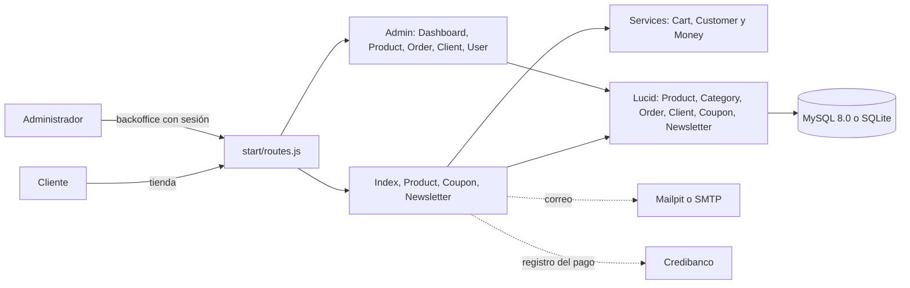

# Tienda en línea de droguería con backoffice (AdonisJS)

[](https://github.com/KevinAndrey96/adonisjs-pharmacy-ecommerce-platform/actions/workflows/ci.yml)


Tienda en línea para una droguería colombiana, con catálogo de medicamentos de venta libre, cuidado personal e higiene oral, y su backoffice de inventario, pedidos y clientes. Se construyó en 2020 con AdonisJS 4, Edge y Lucid; los clientes compran sin crear cuenta y pagan contraentrega o con la pasarela de Credibanco.

## Funcionalidades

**Tienda**

- Portada con cinco vitrinas por categoría, categorías y detalle de producto con relacionados.
- Búsqueda por nombre, categoría padre o categoría, filtro por precio mínimo y máximo, y orden por precio o nombre.
- Carrito en el navegador. El checkout recalcula cada línea con el precio de la base de datos, nunca con el que envía el navegador, limita las cantidades a 1..20 y suma un envío fijo de $ 1.700.
- Datos de envío obligatorios y validados en el servidor; nadie puede consultar los datos de otro cliente por su correo.
- Cupones de un solo uso que descuentan sobre el subtotal, y boletín que entrega un cupón de bienvenida generado con `crypto` (uno por correo).
- Pago contraentrega por defecto. Con `ENABLE_PAYMENT_GATEWAY=true` aparece la opción de pasarela: el pedido se registra en Credibanco y el cliente pasa a su formulario de pago; si la pasarela falla o no responde en 10 segundos, el pedido queda pendiente y el error se registra en el log.
- Correo de confirmación del pedido.

**Backoffice** (`/login`, con sesión)

- Tablero con productos, categorías, pedidos, clientes e ingresos, y los últimos pedidos.
- Productos con imagen (PNG, JPG o GIF de hasta 10 MB), pedidos con detalle y edición de clientes.
- Los visitantes sin sesión se redirigen al login, y todos los formularios llevan token CSRF (Shield).

## Arquitectura



- `app/Services/Cart.js` interpreta el carrito y lo resuelve contra el catálogo.
- `app/Services/Customer.js` valida los datos de envío del checkout.
- `app/Services/Money.js` formatea pesos colombianos para todas las vistas.
- `app/Exceptions/Handler.js` redirige al login cuando falta la sesión en el backoffice.

## Puesta en marcha

### Local con SQLite

```bash
npm ci --legacy-peer-deps
cp .env.example .env
sed -i.bak "s/^APP_KEY=.*/APP_KEY=$(openssl rand -hex 16)/" .env && rm .env.bak
node ace migration:run
node ace seed
npm run dev        # http://127.0.0.1:3333
```

### Docker Compose (MySQL y Mailpit)

```bash
export APP_KEY=$(openssl rand -hex 16)
docker compose up -d --build
docker compose exec app node ace migration:run --force
docker compose exec app node ace seed --force
```

- Tienda: http://localhost:3333
- Mailpit: http://localhost:8025

La imagen corre como el usuario `node`, sin privilegios, y tiene healthcheck. El compose exige `APP_KEY`: no trae una clave por defecto.

### Pasarela de pago

| Variable | Uso |
| --- | --- |
| `ENABLE_PAYMENT_GATEWAY` | `true` muestra la opción de pasarela y registra el pago en Credibanco; cualquier otro valor deja solo contraentrega. |
| `GATEWAY_USERNAME`, `GATEWAY_PASSWORD` | Credenciales del comercio. Son obligatorias si la pasarela está activa. |
| `GATEWAY_URL` | Endpoint `register.do`; por defecto, el ambiente de pruebas de Credibanco. |

### Datos de demostración

El seeder crea categorías, productos, los cupones `BIENVENIDO10` y `SALUD20` y el usuario `admin@example.com` con la contraseña `adminpassword123`, solo para el entorno local.

## Calidad

```bash
npm run lint   # ESLint
npm test       # pruebas HTTP con node:test
```

Las pruebas levantan el servidor real sobre la base SQLite sembrada y revisan:

- que las páginas de la tienda y la búsqueda carguen;
- los endpoints JSON del carrito y de cupones;
- los 404;
- la redirección del backoffice al login;
- que no exista la consulta de clientes por correo;
- el rechazo de un POST sin token CSRF y de un checkout sin datos de envío;
- el boletín, que entrega un solo cupón por correo;
- una compra completa con cupón, que confirma el precio de la base, el límite de cantidad, el descuento sobre el subtotal, el envío y el cupón marcado como usado;
- que una pasarela caída deje el pedido pendiente y muestre la confirmación.

El CI corre lint y pruebas en Node 18, 20 y 22, construye la imagen Docker y espera a que el contenedor quede saludable.

## Historia

Proyecto de 2020 y 2021 para una droguería de Bogotá, hecho con Camilo Gamba. En noviembre de 2026 se ordenó sin cambiar el stack:

- se quitó el endpoint que devolvía nombre, teléfono y dirección de cualquier cliente a partir de su correo;
- el checkout valida los datos de envío en el servidor;
- los precios del carrito salen del catálogo y las cantidades negativas o enormes ya no alteran el total;
- el descuento del cupón ya no se calcula en el navegador sobre un total sin envío;
- un producto o cupón inexistente responde 404 en lugar de 500;
- los correos que fallan ya no tumban el pedido, y los errores de la pasarela quedan registrados;
- la búsqueda se reescribió como una sola consulta, y la lógica de carrito, cliente y moneda pasó a servicios;
- se eliminaron dependencias sin uso;
- el lockfile se regeneró, la imagen Docker corre sin root y se agregaron ESLint, pruebas y CI.

Las credenciales que alguna vez estuvieron en el código se purgaron del historial.

## Licencia

Sin licencia de código abierto. El proyecto nació como trabajo para un cliente y se publica como muestra de portafolio: todos los derechos reservados.
