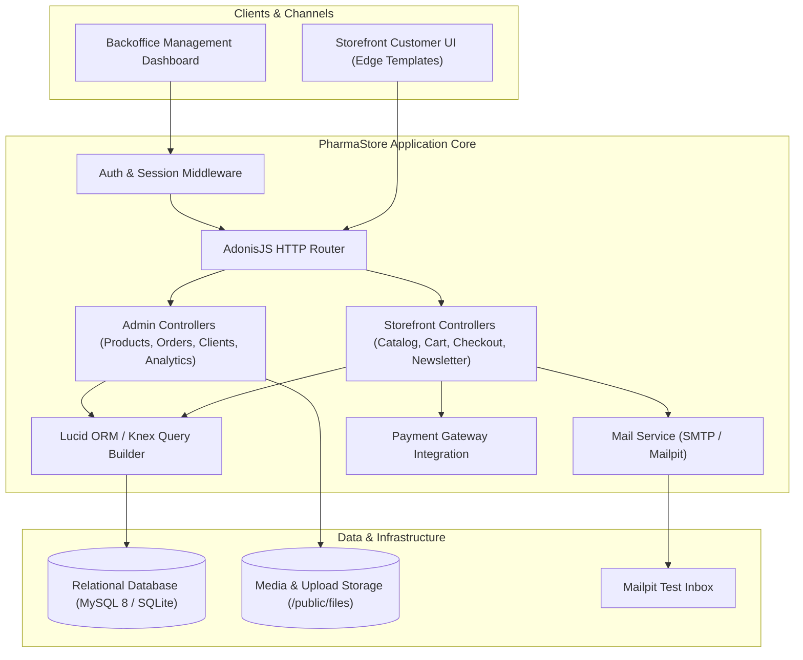

# PharmaStore E-Commerce Platform

[](https://github.com/KevinAndrey96/pharmacy-ecommerce-platform/actions/workflows/ci.yml)
[](https://nodejs.org/)
[](https://adonisjs.com/)
[](https://opensource.org/licenses/MIT)

An open-source, full-stack pharmacy and drugstore e-commerce platform with an integrated administrative backoffice for catalog, inventory, and order management. Built on Node.js and AdonisJS with support for MySQL and SQLite.

---

## 📑 Architecture Overview



---

## ✨ Features

### Storefront
- **Product Catalog & Search**: Real-time filtering by therapeutic category, parent classification, price range, and alphabetical order.
- **Cart & Checkout Workflow**: Session-backed multi-item shopping cart, shipping calculations, and coupon redemption engine.
- **Payment Processing**: Multi-gateway abstraction supporting Cash-on-Delivery (contraentrega) and hosted payment gateway redirection.
- **Newsletter Engine**: Automated customer onboarding that generates unique single-use promotional coupons delivered via email.

### Administration Backoffice
- **Secure Authentication**: Role-aware session authentication with encrypted credential verification.
- **Catalog Management**: Full CRUD capabilities for pharmaceutical products, SKU codes, pricing, categories, and image uploads.
- **Orders & Fulfillment**: End-to-end tracking of customer orders, status transitions, and items detail.
- **Customer CRM**: Centralized directory of registered clients, addresses, and order history.
- **Executive Metrics**: Analytical dashboard tracking gross volume, total orders, catalog size, and customer base.

---

## 🚀 Quick Start

### Option A: Local Development (SQLite)

1. **Clone repository and install dependencies**:
   ```bash
   git clone git@github.com-personal:KevinAndrey96/pharmacy-ecommerce-platform.git
   cd pharmacy-ecommerce-platform
   npm install
   ```

2. **Configure environment variables**:
   ```bash
   cp .env.example .env
   # Set DB_CONNECTION=sqlite for instant local zero-setup execution
   ```

3. **Run migrations and seed pharmaceutical catalog**:
   ```bash
   node ace migration:run
   node ace seed
   ```

4. **Launch development server**:
   ```bash
   npm start
   # Server listens on http://127.0.0.1:3333
   ```

Default administrative credentials:
- **URL**: `http://localhost:3333/login`
- **Email**: `admin@pharmastore.local`
- **Password**: `adminpassword123`

---

### Option B: Docker Compose (Full Stack with MySQL & Mailpit)

Launch the complete isolated stack with a single command:

```bash
make docker-up
```

Services exposed:
- **Web Application**: `http://localhost:3333`
- **Mailpit Web UI (Email Inbox)**: `http://localhost:8025`
- **MySQL Database**: `localhost:3306`

Run migrations inside the container:
```bash
make docker-migrate
make docker-seed
```

---

## 🛠️ Makefile Command Reference

| Target | Description |
| :--- | :--- |
| `make help` | Display list of available build and lifecycle commands. |
| `make dev` | Start AdonisJS server locally with `.env` autoloading. |
| `make migrate` | Execute pending database migrations. |
| `make rollback` | Rollback the most recent migration batch. |
| `make seed` | Populate database with pharmaceutical categories and products. |
| `make docker-up` | Build and run application, MySQL 8, and Mailpit containers. |
| `make docker-down`| Stop and clean up all Docker Compose resources. |
| `make docker-logs`| Tail logs across running containers. |

---

## 🔒 Security & Privacy

- Historical sensitive keys and local secrets have been scrubbed from git history.
- Payment gateway credentials, database connections, and SMTP configuration are driven strictly through environment variables.
- CSRF protection and input sanitization are enabled globally via `@adonisjs/shield`.

---

## 📄 License

This project is licensed under the [MIT License](LICENSE).
